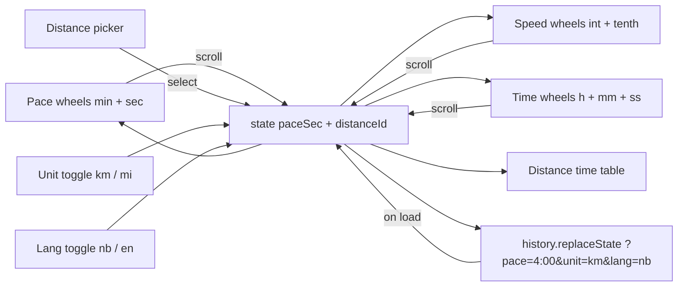

# Pace – plan

Static single‑page app published at **https://knekk.github.io/pace/** (own GitHub repo `pace`,
GitHub Pages from `main` / root – same setup as robotspillet).

Converts running pace ↔ speed with scrollable "wheel" pickers, and shows finish times for
standard distances at the chosen pace.

## Requirements (from brief)

- Scroll minutes and seconds of pace (e.g. `4:00 min/km` → `15.0 km/h`).
- Scroll speed too; pace and speed are linked both ways.
- Small toggle (off by default) to switch to miles (`min/mi` + `mph`).
- Tastefully show finish times for: 400 m, 800 m, 1000 m, 2000 m, 3000 m, 5 km, 10 km, HM, M.
- Norwegian default, switch to English via button **and** URL (`?lang=en`).
- Good‑looking design.
- **Third card – Finish time:** pick a distance (same 9 as the table) and scroll a target time
  `h : mm : ss`; the pace and speed cards update to match (e.g. 10 km in 45:00 → 4:30/km).

## Tech

- Plain HTML + CSS + JS (ES modules). No build step, no dependencies (same as robotspillet).
- Wheels are built with native vertical scrolling + `scroll-snap-type: y mandatory`.
  Works with touch, mouse‑wheel, trackpad and keyboard. Selection is read on `scrollend`
  (with a debounced `scroll` fallback for Safari).
- Pure math in its own module so it can be unit‑tested with `node --test`.

```
pace/
├── index.html
├── css/style.css
├── js/
│   ├── main.js      # boot, wires state ↔ wheels ↔ table ↔ URL
│   ├── state.js     # single source of truth: paceSecPerKm, unit, lang
│   ├── pace.js      # pure functions: pace↔speed, unit conversion, time formatting
│   ├── wheel.js     # reusable Wheel component (scroll‑snap list)
│   ├── i18n.js      # nb + en strings, lang detection from URL/localStorage
│   └── distances.js # distance table (metres + labels)
├── test/pace.test.mjs
├── README.md
├── LICENSE (MIT)
└── .gitignore
```

## Data model

Single canonical value: **`paceSec` = seconds per kilometre** (integer‑ish, float allowed).
Everything else is derived:

| Derived          | Formula                                   |
|------------------|-------------------------------------------|
| km/h             | `3600 / paceSec`                          |
| min/mi (sec/mi)  | `paceSec * 1.609344`                      |
| mph              | `3600 / (paceSec * 1.609344)`             |
| time for *d* m   | `paceSec * d / 1000`                      |

Rounding rules:

- Pace wheels show whole seconds. Speed wheels show one decimal (e.g. `15.0`).
- When the user scrolls **pace**, speed is recomputed and rounded to 0.1.
- When the user scrolls **speed**, pace is recomputed and rounded to the nearest second.
- Finish times are always computed from the exact canonical `paceSec` (not the rounded display),
  shown as `m:ss` under 1 h and `h:mm:ss` above.

- When the user scrolls **finish time**, `paceSec = totalSec / (distanceM / 1000)` (exact float,
  not rounded – so 10 km in 45:30 gives 4:33.0/km and the table stays consistent).
- When pace changes from any other card, the finish‑time wheels are set to the time for the
  selected distance, rounded to the nearest second.

Ranges:

- Pace: 2:00 – 15:59 per km (per mile: 3:00 – 25:59). Minutes wheel + seconds wheel (00–59).
- Speed: 3.0 – 30.0 km/h (2.0 – 19.0 mph). Integer wheel + tenths wheel (.0–.9).
- Finish time: hours wheel 0–9, minutes 00–59, seconds 00–59. Resulting pace is clamped to the
  pace range above; the time wheels then snap back to the clamped value.
- Out‑of‑range values are clamped.

## State flow



A `programmatic` flag on each wheel prevents feedback loops when the state scrolls a wheel
into position.

## UI / design

- Dark, sporty theme: near‑black background, one bright accent (e.g. lime `#c6ff3d` or
  orange), big tabular‑figure numerals (`font-variant-numeric: tabular-nums`), system font
  stack with `Inter`/`Segoe UI` fallback.
- Layout (desktop): three cards in a row – **Pace** (min : sec), **Speed** (int . tenth) and
  **Finish time** (h : mm : ss with a distance picker above the wheels) – separated by small
  `=` glyphs. Tablet: 2 + 1. Mobile: stacked.
- Distance picker in the Finish‑time card: a compact segmented control / horizontally
  scrollable chip row (`400 · 800 · 1k · 2k · 3k · 5k · 10k · HM · M`), default **10 km**.
  Clicking a distance in the table below also selects it here (the selected row is highlighted
  with the accent colour so the link between the two is obvious).
- Each wheel: fixed row height (e.g. 56 px), 5 visible rows, centre row highlighted with a
  subtle pill, top/bottom fade via `mask-image: linear-gradient(...)`. Unit label
  (`min/km`, `km/h`) sits under each card and updates with the unit toggle.
- Unit toggle: small pill switch `km | mi` in the header, **km** active by default.
- Language toggle: small `NO | EN` text button in the header.
- Distance table below the cards: a responsive grid of 9 chips/cards, each with distance label
  on top (`400 m`, `800 m`, `1 km`, `2 km`, `3 km`, `5 km`, `10 km`, `HM`, `M`) and the time in
  large digits. HM/M get a tooltip/subtitle (`21,1 km` / `42,2 km`, or `13.1 mi` / `26.2 mi`
  in mile mode). Times animate briefly (fade) on change.
- Respect `prefers-reduced-motion`. `theme-color` meta for mobile chrome.
- Keyboard: wheels focusable; ↑/↓ step one row, PageUp/PageDown step 10, Home/End to limits.
- Initial value on first visit: `5:00 min/km` (12.0 km/h). Last value persisted in `localStorage`.

## URL parameters

| Param   | Example          | Notes                                   |
|---------|------------------|-----------------------------------------|
| `lang`  | `?lang=en`       | `nb` (default) or `en`; wins over saved |
| `unit`  | `?unit=mi`       | `km` (default) or `mi`                  |
| `pace`  | `?pace=4:30`     | in the current `unit`                   |
| `speed` | `?speed=15`      | used if `pace` absent                   |
| `dist`  | `?dist=10k`      | selected distance: `400,800,1k,2k,3k,5k,10k,hm,m` |
| `time`  | `?time=45:00`    | with `dist`: sets pace from finish time (wins over `pace`/`speed`) |

URL is kept in sync (replaceState) so the page can be shared/bookmarked.

## i18n strings (nb / en)

title, pace, speed, finishTime, distance, hours, minutes, seconds, perKm, perMi, kmh, mph,
distances, halfMarathon, marathon, unitToggleLabel, langToggleLabel, shareHint, footer.

## Tests (`node --test test/pace.test.mjs`)

- `4:00/km` → `15.0 km/h`; `15 km/h` → `4:00/km`.
- `5:00/km` → `8:03/mi` (±1 s) and `7.46 mph`.
- Times: `4:00/km` → 400 m `1:36`, 5 km `20:00`, HM `1:24:23`, M `2:48:47`.
- Formatting: `< 1h` as `m:ss`, `≥ 1h` as `h:mm:ss`.
- Finish time → pace: 10 km in `45:00` → `4:30/km`; HM in `1:30:00` → `4:16/km` (±1 s);
  M in `3:00:00` → `4:16/km`; 400 m in `1:20` → `3:20/km`.
- Clamping of out‑of‑range pace/speed and of finish times that imply out‑of‑range pace.

## Deployment

1. `git init` in `C:/Users/totli/Documents/Dev/pace`, first commit.
2. Create public repo `knekk/pace`, push `main`.
3. Settings → Pages → Deploy from branch `main` / root.
4. Live at `https://knekk.github.io/pace/`.

With the GitHub CLI (from the `pace` directory):

```
git init -b main
git add -A
git commit -m "Pace calculator: pace, speed and finish time wheels"
gh repo create knekk/pace --public --source=. --remote=origin --push
gh api -X POST repos/knekk/pace/pages -f "source[branch]=main" -f "source[path]=/"
```

## Status (2026‑10‑19)

All modules, styles, tests, README, LICENSE and icon are written. Remaining work:

### Fixes found in review

- [x] `main.js` `buildWheels()`: hours wheel is `0–9`; marathon at 15:59/km is `11:14:25`.
      Use `rangeItems(0, 11)`.
- [x] `wheel.js` `rowHeight`: `offsetHeight` can be `0` before layout → `NaN` index.
      Return `first.offsetHeight || 56`.
- [x] `main.js` `renderChips()`: `scrollIntoView` can scroll the page vertically on load.
      Centre the active chip with `wrap.scrollLeft` instead.
- [ ] (nice‑to‑have) `wheel.js` `setValue()`: skip the instant `scrollTo` when the wheel is
      already animating towards the same index. `scrollToIndex` already skips when
      `scrollTop` is within 0.5 px, and `setValue` from state is a no‑op for the wheel that
      triggered the change, so this is cosmetic only.

### Verification

- [x] `node --test test/pace.test.mjs` passes (8/8).
- [ ] Manual check in browser: pace ↔ speed ↔ time linking, km/mi toggle, NO/EN toggle,
      URL params, table click selects distance, mobile layout.

### Deploy

- [x] `git init -b main`, first commit `d384570`.
- [x] `gh repo create knekk/pace --public --source=. --remote=origin --push`.
- [x] Pages enabled via `gh api` (branch `main`, path `/`) → `https://knekk.github.io/pace/`.
